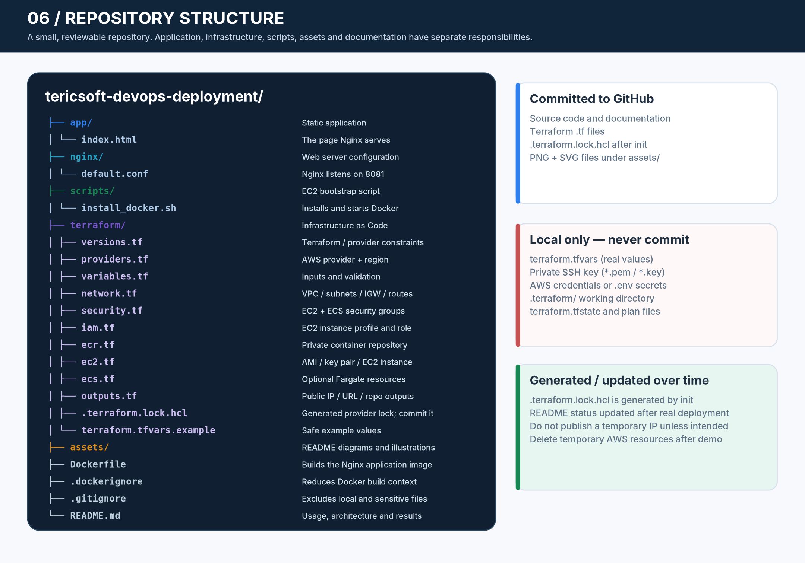
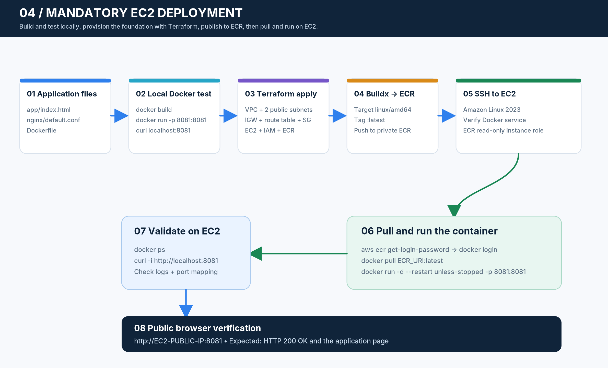
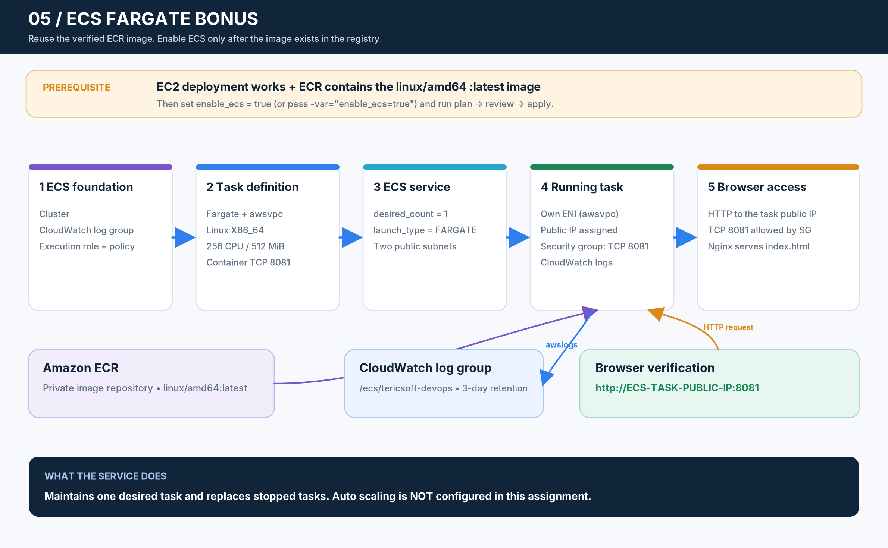

## Project Overview

This project packages a small static website in a Docker image using Nginx. The application listens on port 8081 and is deployed on Amazon EC2 (mandatory) and Amazon ECS Fargate (bonus), with infrastructure managed by Terraform.


## Deployment Status

| Target | URL | Status |
|---|---|---|
| Amazon EC2 (mandatory) | `http://43.205.139.240:8081` | ✅ Live — verified HTTP 200 |
| Amazon ECS Fargate (bonus) | `http://15.206.209.182:8081` | ✅ Live — verified HTTP 200 |

> **Note:** The EC2 public IP and ECS task public IP are ephemeral. The ECS task IP changes if the service restarts the task. Both URLs were verified at deployment time. Temporary resources will be destroyed after the assessment recording.

## Technology Stack

- HTML / CSS
- Nginx (web server, listening on port 8081)
- Docker (containerisation, `linux/amd64` image built with Buildx)
- Terraform (infrastructure as code)
- Amazon VPC, subnets, Internet Gateway, route tables
- Amazon EC2 — Amazon Linux 2023, `t3.micro`, 8 GiB encrypted gp3
- Amazon ECR (private container registry)
- Amazon ECS Fargate — Linux X86_64, 256 CPU units, 512 MiB
- Amazon CloudWatch Logs (ECS container logs, 3-day retention)
- Git and GitHub

## AWS Region

`ap-south-1` (Mumbai)

## Project Structure



```text
.
├── app/
│   └── index.html
├── assets/
│   └── (diagrams and illustrations)
├── nginx/
│   └── default.conf
├── scripts/
│   └── install_docker.sh
├── terraform/
│   ├── versions.tf
│   ├── providers.tf
│   ├── variables.tf
│   ├── network.tf
│   ├── security.tf
│   ├── iam.tf
│   ├── ecr.tf
│   ├── ec2.tf
│   ├── ecs.tf
│   ├── outputs.tf
│   ├── .terraform.lock.hcl
│   └── terraform.tfvars.example
├── Dockerfile
├── .dockerignore
├── .gitignore
└── README.md
```

## Run Locally


Build the image:

```bash
docker build -t tericsoft-devops:1.0 .
```

Run the container:

```bash
docker run -d --name tericsoft-devops -p 8081:8081 tericsoft-devops:1.0
```

Open:

```text
http://localhost:8081
```

Stop and remove the test container:

```bash
docker stop tericsoft-devops
docker rm tericsoft-devops
```

## AWS Deployment


Infrastructure is provisioned in two Terraform applies:

**Apply 1 — EC2 and ECR foundation (`enable_ecs = false`)**

```bash
terraform -chdir=terraform plan -out=tfplan
terraform -chdir=terraform apply tfplan
```

Creates: VPC, Internet Gateway, 2 public subnets, route table, security groups, IAM role and instance profile, ECR repository, EC2 key pair, EC2 instance.

**Apply 2 — ECS Fargate bonus (`enable_ecs = true`)**

```bash
terraform -chdir=terraform plan -var="enable_ecs=true" -out=ecs-plan
terraform -chdir=terraform apply ecs-plan
```

Creates: ECS cluster, CloudWatch log group, ECS execution IAM role, task definition, ECS service.

### EC2 Deployment



- **Instance:** Amazon Linux 2023, `t3.micro` (2 vCPU, 1 GiB RAM), 8 GiB encrypted gp3 root volume
- **Region:** `ap-south-1`
- **Container:** pulled from ECR using the EC2 instance profile (no personal credentials on the server)
- **Verified:** `curl http://43.205.139.240:8081` returns HTTP 200 from both inside EC2 and from the public internet

### ECS Fargate Deployment (Bonus)



- **Cluster:** `tericsoft-devops-cluster`
- **Service:** `tericsoft-devops-service`, desired count 1, running count 1
- **Task:** Linux X86_64, 256 CPU units, 512 MiB, `awsvpc` networking, public IP assigned
- **Same ECR image** used by both EC2 and ECS — `linux/amd64` built with Buildx
- **Logs:** CloudWatch log group `/ecs/tericsoft-devops`, 3-day retention
- **Verified:** `curl http://15.206.209.182:8081` returns HTTP 200 from the public internet

### Network and Security Design


- VPC `10.0.0.0/16` with two public subnets (`10.0.1.0/24`, `10.0.2.0/24`) in `ap-south-1a` and `ap-south-1b`
- Internet Gateway + public route table (`0.0.0.0/0 → IGW`) attached to both subnets
- EC2 security group: TCP 22 from administrator IP `/32` only; TCP 8081 from `0.0.0.0/0`
- ECS security group: TCP 8081 from `0.0.0.0/0`
- No load balancer or NAT Gateway (not required for this demonstration)

## Terraform Outputs

```text
ec2_public_ip      = "43.205.139.240"
ec2_app_url        = "http://43.205.139.240:8081"
ecr_repository_url = "444672582454.dkr.ecr.ap-south-1.amazonaws.com/tericsoft-devops"
ecs_cluster_name   = "tericsoft-devops-cluster"
ecs_service_name   = "tericsoft-devops-service"
```

## Cleanup

Destroy all temporary AWS resources after the assessment:

```bash
terraform -chdir=terraform destroy -var="enable_ecs=true"
```

Verify in the AWS Console that the EC2 instance, ECR repository, ECS cluster, CloudWatch log group, IAM roles, VPC and all related resources have been removed.

## Security Notes

- No personal AWS credentials placed on the EC2 instance — the EC2 instance profile provides ECR read access via IAM role
- SSH access restricted to the administrator's public IP `/32`
- `terraform.tfvars`, SSH private key, `.terraform/`, and Terraform state are gitignored and never committed
- EBS root volume encrypted at rest

## Cost Notes

Resources provisioned: EC2 `t3.micro`, EBS 8 GiB gp3, public IPv4 address, ECR storage, Fargate task (256 CPU / 512 MiB), CloudWatch Logs. Charges apply while running. Run `terraform destroy` after the assessment to stop all billing.
