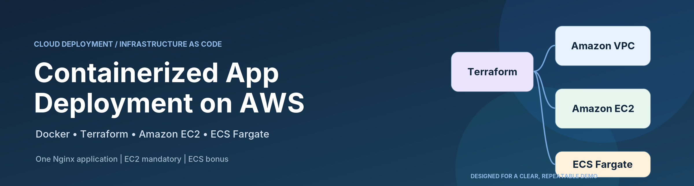
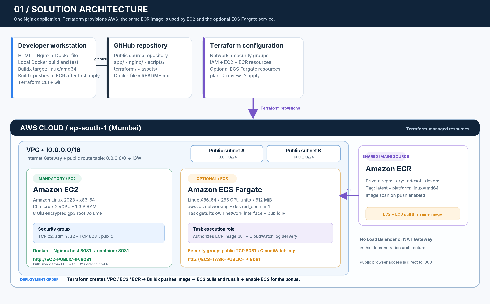
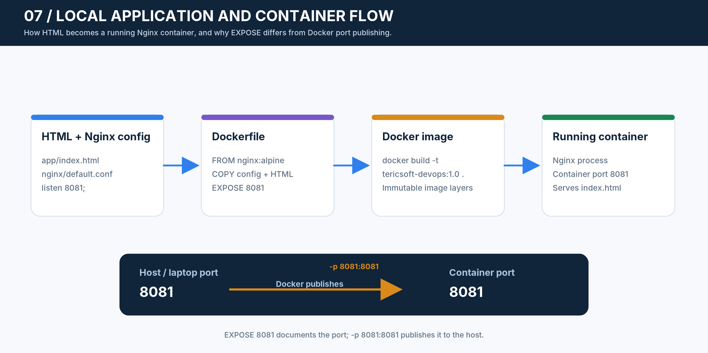
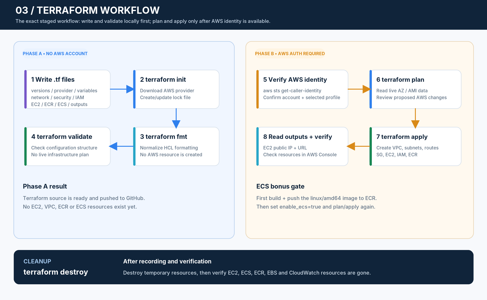
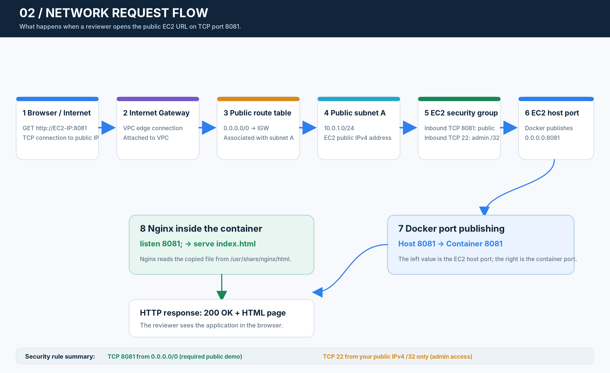

# Tericsoft DevOps Internship — Containerized App Deployment



## Project Overview

This project packages a small static website in a Docker image using Nginx. The application listens on port 8081 and is prepared for deployment on Amazon EC2 and Amazon ECS Fargate.



## Current Status

- Static HTML application created.
- Nginx configured to listen on port 8081.
- Docker image built and tested locally.
- Terraform infrastructure configuration prepared.
- AWS deployment will be documented here after it is actually completed.

## Technology Stack

- HTML
- Nginx
- Docker
- Terraform
- Amazon EC2
- Amazon ECR
- Amazon ECS Fargate
- Git and GitHub

## Project Structure

```text
.
├── app/
│   └── index.html
├── assets/
│   └── (diagrams and illustrations)
├── nginx/
│   └── default.conf
├── scripts/
│   └── install_docker.sh
├── terraform/
│   ├── versions.tf
│   ├── providers.tf
│   ├── variables.tf
│   ├── network.tf
│   ├── security.tf
│   ├── iam.tf
│   ├── ecr.tf
│   ├── ec2.tf
│   ├── ecs.tf
│   ├── outputs.tf
│   ├── .terraform.lock.hcl
│   └── terraform.tfvars.example
├── Dockerfile
├── .dockerignore
├── .gitignore
└── README.md
```

## Run Locally



Build the image:

```bash
docker build -t tericsoft-devops:1.0 .
```

Run the container:

```bash
docker run -d --name tericsoft-devops -p 8081:8081 tericsoft-devops:1.0
```

Open:

```text
http://localhost:8081
```

Stop and remove the test container:

```bash
docker stop tericsoft-devops
docker rm tericsoft-devops
```

## AWS Deployment



The AWS resources are defined using Terraform in the `terraform/` directory. The deployment instructions and verified outputs will be added after the AWS environment has been provisioned.

### Network and security design



## Security Notes

- Do not commit SSH private keys, AWS credentials, local `.env` files, Terraform state or local Terraform variable files.
- SSH access is restricted to the administrator's current public IP address.
- Public HTTP access on port 8081 is enabled for the assignment demonstration.

## Cost Notes

AWS resources may incur charges. Review the AWS Billing and Pricing pages before deployment and destroy temporary resources after the demonstration.
